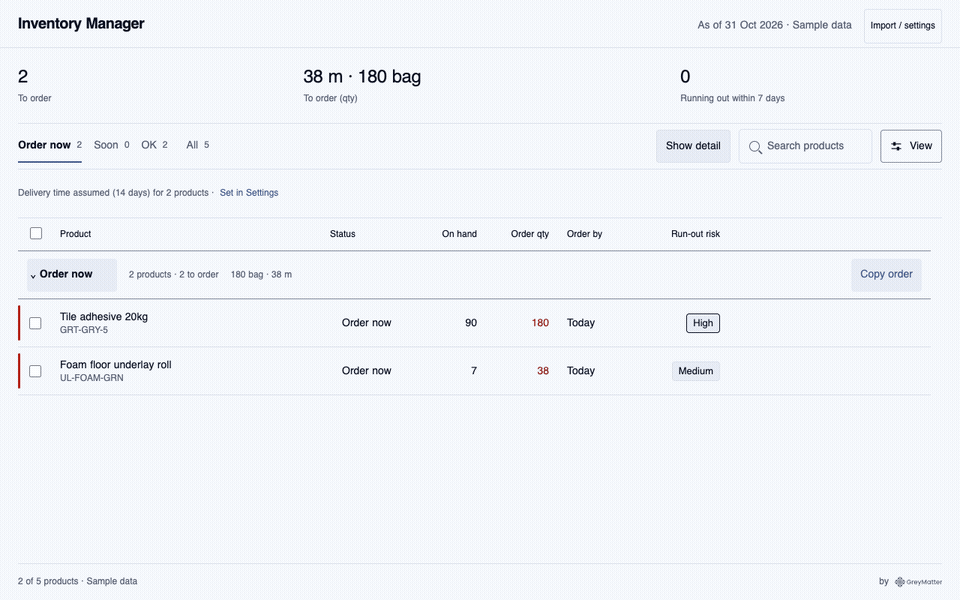

# Inventory Manager by GreyMatter — free inventory reorder planner

**Beta:** free and ready to try with your own data. It has been tested on example data; feedback is welcome.

**Free, open-source reorder planner: what to buy, how much, by when. Offline, and your data stays on your device.**



<sub>Still images: [light](docs/img/worklist-light.png) · [dark](docs/img/worklist-dark.png). All demos use synthetic data.</sub>

## Try it

**[Open the demo](https://usegreymatter.github.io/inventory-manager/)** · [Source repository](https://github.com/usegreymatter/inventory-manager)

The Pages link above opens the demo directly in your browser. For offline use, download **`inventory-manager-1.2.0-beta.html`** when it is published as a release asset, or open [`standalone/inventory-manager.html`](standalone/inventory-manager.html) on GitHub and choose **Download raw file** (not Save Page on the code preview). Open the downloaded `.html` file in any modern browser: double-click it or use **Open with → your browser**. It is one file and needs no server, account, install or internet. A 1,000-product synthetic demo is in [`standalone/inventory-manager-demo-1000.html`](standalone/inventory-manager-demo-1000.html); download and open it the same way. Every built HTML carries the MIT license and [THIRD_PARTY_NOTICES.md](THIRD_PARTY_NOTICES.md). Only `option-gm-c` embeds Poppins and Tajawal and includes their OFL notice and full license; keep [LICENSES/OFL-1.1.txt](LICENSES/OFL-1.1.txt) alongside redistributed copies of that variant. The shipped Arctic page and its demos use system fonts.

To keep a local copy:

```sh
git clone https://github.com/usegreymatter/inventory-manager.git
cd inventory-manager
```

## Use your own file

Choose **Import Excel or CSV** and pick your Excel or CSV export. Smart import matches your column names (it knows common ERP headers), shows a preview of what it understood, and sets aside rows it can't read rather than guessing. The file is read in the browser and never uploaded. Details: [docs/GUIDE.md](docs/GUIDE.md#import-check-before-replacing-your-products).

## What it does NOT do

- It is **not an inventory system.** It reads a snapshot of stock and sales; it does not track stock.
- It **never places orders,** sends email or writes to your ERP. You copy or export the list yourself.
- **Forecasts are estimates.** The methods have not been validated on your data. Check the numbers before you buy.

## How the maths works

The selected method forecasts monthly demand; the planner consumes it across actual calendar months. Physical run-out uses stock on hand and dated confirmed receipts, not undated on-order stock. Reorder timing also considers inventory position and supplier delivery time; buffer days add extra demand to the purchase target. Purchase quantity covers forecast demand over the planning window, subtracts available stock and incoming supply, optionally adds safety stock, then applies minimum/pack rounding. Missing incoming supply stays unknown in source data and exports, but estimates assume 0 incoming: check existing orders before buying. Unusable stock or sales inputs are held for review; missing lead time uses the configured fallback or holds purchase advice if none is available. Full rules: [docs/GUIDE.md](docs/GUIDE.md), [docs/terminology.md](docs/terminology.md), [docs/data/CONTRACT.md](docs/data/CONTRACT.md).

Defaults (from `DEFAULT_ORDER_SETTINGS` in `engine.py`): delivery time 14 days, 2 months of cover, buffer 0 days, 95% service level, **safety stock added to orders: on**.

### Industry setup guides (v1.2 candidate)

The industry buttons are **setup guides for ordering rhythm and shelf-life prompts**, not quantity optimizers. They ask you to check the actual ordering interval and enter verified shelf-life facts for applicable products; they do not silently set an ordering cadence or guess shelf life. **They do not change order amounts on their own from General defaults.** Confirming ordinary-setting changes, such as raising insufficient cover or resetting custom settings with General, can change amounts; review the before/after preview before applying. Pharmacy's automatic 99% service target was removed after it failed the independent synthetic gate; the user's chosen target is preserved. The remaining guides matched General quantities in the weekly/monthly synthetic comparison, not evidence of better real-world performance. See [industry setup guides, exact settings and evidence](docs/PRESETS.md) and [beta notes](docs/release-notes/v1.2.0-beta.md).

## Forecast methods

- **Current** (default): the original recent-sales estimate. All numbers above use it.
- **Auto** (experimental, opt-in): picks a method per product from a fixed rule table based on its sales pattern (steady, seasonal, intermittent…). It is not proven better than Current. See [docs/forecast-methods-spec.md](docs/forecast-methods-spec.md).

## Python CLI quickstart

Python 3 standard library only; nothing to install.

```sh
python3 stock_runway.py samples/synthetic/stock.csv --today 2026-11-12
python3 stock_runway.py samples/synthetic --bundle --today 2026-11-12 -o orders.csv
python3 stock_runway.py --help
```

The first reviews the input and prints an order list as CSV if no acknowledgement is needed; the second reads a canonical CSV bundle ([contract](docs/data/CONTRACT.md)) and writes `orders.csv`.

Every single CSV gets an `Input meaning: {…}` report on stderr. Exit **2** can mean input review needs acknowledgement (for example, the latest sales month is still in progress), as well as an argument/file error: check the reported risks, then use `--show-orders-anyway` to acknowledge them, not repair them. `--stock-includes-reserved` subtracts a recognised reserved/allocated column; `--incoming-not-in-file` ignores incoming in this file, retains `incoming_unknown` and counts it as 0, with a warning to check open POs. These interpretation flags are for single CSV files, not `--bundle`; the reserved flag cannot be combined with `--strict`. Full rules, optional read-only Odoo access and the Hermes Desktop plugin: [docs/GUIDE.md](docs/GUIDE.md#planning-and-order-export).

Stock CSV imports also print an **Input meaning** review to stderr. Flagged risks block order output with **exit code 2** until you check the file and explicitly pass `--show-orders-anyway`; acknowledgement does not repair invalid rows. Use `--stock-includes-reserved` only when stock includes allocations and a reserved column should be deducted, or `--incoming-not-in-file` to ignore undated incoming quantities and keep incoming supply explicitly unknown (separate confirmed receipts remain). These two interpretation flags are for a stock CSV, not a canonical bundle; the reserved flag cannot be combined with `--strict`.

Leading blank monthly sales before the first recorded value are counted as **not yet launched**, not missing sales; internal and trailing blanks still need review. A latest sales month still in progress warns that partial sales may lower the forecast and requires fresh acknowledgement. This review does not change the forecast maths or automatically remove the current month.

For a readable quantity explanation, use `--explain` (CSV) or `--json`. Explanation terms normally display to two decimal places, with a **display rounding** ledger term if needed to make the visible sum match the displayed order. This is formatting, not another purchase adjustment; fractional order quantities can retain up to six decimals. JSON also includes the exact `why_breakdown` ledger and `input_warnings`. See [the explanation contract](docs/WHY-THIS-AMOUNT.md).

## For AI agents

Start with [AGENTS.md](AGENTS.md) and [llms.txt](llms.txt). Recipes: [docs/AI-GUIDE.md](docs/AI-GUIDE.md). The [local read-only MCP server](docs/architecture/MCP.md) lets assistants list reorders, explain an item and check data health from one CSV/bundle snapshot. Start it with `python3 -B /absolute/checkout/mcp_server.py --csv /absolute/data/stock.csv`; client config examples are in its contract. Other connectors, auto-reorder and MCP draft/write tools remain **roadmap designs only** ([docs/ROADMAP-CONNECT.md](docs/ROADMAP-CONNECT.md)).

## Privacy

The page and the CLI run locally. No analytics, no telemetry, no network requests. Imported files, settings and local order lists stay in your browser or on your disk. The built-in sample is fully synthetic, generated by `scripts/generate_sample.py` (seed 731209); the 1,000-product demo and `samples/synthetic/` are also fully synthetic.

## Contributing

See [CONTRIBUTING.md](CONTRIBUTING.md) and [CODE_OF_CONDUCT.md](CODE_OF_CONDUCT.md). Security issues: [SECURITY.md](SECURITY.md). Changes: [CHANGELOG.md](CHANGELOG.md).

## License

[MIT](LICENSE) © 2026 Inventory Manager contributors. Only `option-gm-c` embeds Poppins and Tajawal, under the SIL Open Font License; the other variants use system fonts. See [THIRD_PARTY_NOTICES.md](THIRD_PARTY_NOTICES.md).
