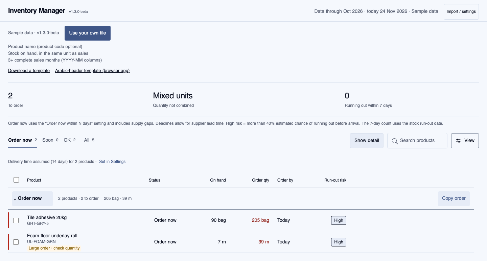

# Inventory Manager by GreyMatter — free inventory reorder planner

**Beta:** v1.3.0-beta — **free, offline, and looking for pilot shops** to try their own exports and tell us what is unclear. [Share feedback or volunteer in an issue](https://github.com/usegreymatter/inventory-manager/issues). [Release notes](docs/release-notes/v1.3.0-beta.md).

**Free, open-source reorder planner: what to buy, how much, by when. Offline, and your data stays on your device.**



<sub>Still images: [light](docs/img/worklist-light.png) · [dark](docs/img/worklist-dark.png). All demos use synthetic data.</sub>

## Try it

**[Open the demo](https://usegreymatter.github.io/inventory-manager/)** · [Source repository](https://github.com/usegreymatter/inventory-manager) · [Check for a newer version](https://github.com/usegreymatter/inventory-manager/releases)

The Pages link above opens the hosted demo; it may lag this checkout. For offline use, open [`standalone/inventory-manager.html`](standalone/inventory-manager.html) on GitHub and choose **Download raw file** (not Save Page on the code preview). You can also check [Releases](https://github.com/usegreymatter/inventory-manager/releases) for a published HTML download and its version. These notes do not mean a v1.3.0-beta release asset has been published. Open the downloaded `.html` file in any modern browser: double-click it or use **Open with → your browser**. It is one file and needs no server, account, install or internet. A 1,000-product synthetic demo is in [`standalone/inventory-manager-demo-1000.html`](standalone/inventory-manager-demo-1000.html); download and open it the same way. Every built HTML carries the MIT license and [THIRD_PARTY_NOTICES.md](THIRD_PARTY_NOTICES.md). Only `option-gm-c` embeds Poppins and Tajawal and includes their OFL notice and full license; keep [LICENSES/OFL-1.1.txt](LICENSES/OFL-1.1.txt) alongside redistributed copies of that variant. The shipped Arctic page and its demos use system fonts.

To keep a local copy:

```sh
git clone https://github.com/usegreymatter/inventory-manager.git
cd inventory-manager
```

## Use your own file

Click **Use your own file** beside the sample and pick your Excel or CSV export. Need a starting sheet? **Download a template** saves a small synthetic CSV; an **Arabic-header template (browser app)** is also available. **CLI/MCP need English headers: use the English template.** Replace its example products and sales with your own. Include product name, stock on hand and at least three complete months of sales (`YYYY-MM` columns); product code is optional for unique product names. Smart import matches your column names (it knows common ERP headers), shows a preview of what it understood, and sets aside rows it can't read rather than guessing. The file is read in the browser and never uploaded. Details: [docs/GUIDE.md](docs/GUIDE.md#import-check-before-replacing-your-products).

The browser can process **10,000 products in seconds**; actual time depends on your device, file and settings. The Python CLI and local AI/MCP route are slower: allow **30–60 seconds on first start for a few thousand products**, and longer for larger or more complex inputs. These are practical expectations, not guaranteed timings or the same performance claim for every interface.

The **UI is English-only**. Arabic product names and recognised Arabic headers import in the browser; review the matched columns before accepting. Arabic text support is not an Arabic interface translation.

The header separates **Data through** (the latest sales month) from **today** (your device date). Sales more than 45 days old get a gentle reminder to refresh the export.

**Stock counted on** (Import / settings, for the loaded file only; CLI `--stock-date YYYY-MM-DD`, per run) tells the app when your stock on hand was counted (as of the end of that day). It is not saved as a setting. Without it, stock is assumed counted at the end of the last sales month, and the app warns when today is more than 7 days later: sales between month end and the count would otherwise be subtracted twice, making orders too large and run-out dates too early. The date must be inside or after the last sales month and not after today.

Open **Import / settings → Print order** for a printable order list grouped by supplier, with incoming-stock caveats and warnings. Your browser can print it or save it as PDF; nothing is sent. Check open purchase orders first. See [From Odoo/Excel in 5 steps](docs/GUIDE.md#from-odooexcel-in-5-steps).

## What it does NOT do

- It is **not an inventory system.** It reads a snapshot of stock and sales; it does not track stock.
- It **never places orders,** sends email or writes to your ERP. You copy or export the list yourself.
- **Forecasts are estimates.** The methods have not been validated on your data. Check the numbers before you buy.
- It **does not connect live to an ERP or shop system yet.** You export Excel or CSV from your system and open it here.
- It is a **beta**, provided as-is under the MIT license, with no warranty. You stay responsible for what you order.
- Charts and screens in the explainer video are **illustrative** designs using example data, not live app screenshots.

## How the maths works

The selected method forecasts monthly demand; the planner consumes it across actual calendar months. Physical run-out uses stock on hand and dated confirmed receipts, not undated on-order stock. Reorder timing also considers inventory position and supplier delivery time; buffer days add extra demand to the purchase target. Purchase quantity covers forecast demand over the planning window, subtracts available stock and incoming supply, optionally adds safety stock, then applies minimum/pack rounding. Missing incoming supply stays unknown in source data and exports, but estimates assume 0 incoming: check existing orders before buying. Unusable stock or sales inputs are held for review; missing lead time uses the configured fallback or holds purchase advice if none is available. Full rules: [docs/GUIDE.md](docs/GUIDE.md), [docs/terminology.md](docs/terminology.md), [docs/data/CONTRACT.md](docs/data/CONTRACT.md).

Defaults (from `DEFAULT_ORDER_SETTINGS` in `engine.py`): delivery time 14 days, 2 months of cover, buffer 0 days, 95% service level, **safety stock added to orders: on**.

### Industry setup guides

The industry buttons are **setup guides for ordering rhythm and shelf-life prompts**, not quantity optimizers. They ask you to check the actual ordering interval and enter verified shelf-life facts for applicable products; they do not silently set an ordering cadence or guess shelf life. **They do not change order amounts on their own from General defaults.** Confirming ordinary-setting changes, such as raising insufficient cover or resetting custom settings with General, can change amounts; review the before/after preview before applying. Pharmacy's automatic 99% service target was removed after it failed the independent synthetic gate; the user's chosen target is preserved. The remaining guides matched General quantities in the weekly/monthly synthetic comparison, not evidence of better real-world performance. See [industry setup guides, exact settings and evidence](docs/PRESETS.md) and [current beta notes](docs/release-notes/v1.3.0-beta.md).

## Forecast methods

- **Current** (default): the original recent-sales estimate. All numbers above use it.
- **Auto** (experimental, opt-in): picks a method per product from a fixed rule table based on its sales pattern (steady, seasonal, intermittent…). It is not proven better than Current. See [docs/forecast-methods-spec.md](docs/forecast-methods-spec.md).

## Python CLI quickstart

Python 3 standard library only; nothing to install.

```sh
python3 stock_runway.py samples/synthetic/stock.csv --today 2026-11-12
python3 stock_runway.py samples/synthetic --bundle --today 2026-11-12 -o orders.csv
python3 stock_runway.py --help
```

The first reviews the input and prints an order list as CSV if no acknowledgement is needed; the second reads a canonical CSV bundle ([contract](docs/data/CONTRACT.md)) and writes `orders.csv`. A stock CSV can contain at most **10,000 products and 2 MiB**. Include stock on hand and at least three **monthly sales columns**; combine daily or weekly transactions into monthly totals before import.

Every single CSV prints an input review to stderr. Exit **2** can mean input review needs acknowledgement (for example, the latest sales month is still in progress), as well as an argument/file error: check the reported risks, then use `--show-orders-anyway` to acknowledge them, not repair them. `--stock-includes-reserved` subtracts a recognised reserved/allocated column; `--incoming-not-in-file` ignores incoming in this file, retains `incoming_unknown` and counts it as 0, with a warning to check open POs. These interpretation flags are for single CSV files, not `--bundle`; the reserved flag cannot be combined with `--strict`. Full rules, optional read-only Odoo access and the Hermes Desktop plugin: [docs/GUIDE.md](docs/GUIDE.md#planning-and-order-export).

Leading blank monthly sales before the first recorded value are counted as **not yet launched**, not missing sales; internal and trailing blanks still need review. A latest sales month still in progress warns that partial sales may lower the forecast and requires fresh acknowledgement. This review does not change the forecast maths or automatically remove the current month.

For a readable quantity explanation, use `--explain` (CSV) or `--json`. Explanation terms normally display to two decimal places, with a **display rounding** ledger term if needed to make the visible sum match the displayed order. This is formatting, not another purchase adjustment; fractional order quantities can retain up to six decimals. JSON also includes the exact `why_breakdown` ledger and `input_warnings`. See [the explanation contract](docs/WHY-THIS-AMOUNT.md).

## For AI agents

Start with [AGENTS.md](AGENTS.md) and [llms.txt](llms.txt). Recipes: [docs/AI-GUIDE.md](docs/AI-GUIDE.md). The [local read-only MCP server](docs/architecture/MCP.md) lets assistants list reorders, explain an item and check data health from one CSV/bundle snapshot. Client examples are below. Other connectors, auto-reorder and MCP draft/write tools remain **roadmap designs only** ([docs/ROADMAP-CONNECT.md](docs/ROADMAP-CONNECT.md)).

## Use with your AI

To try the local server with the bundled synthetic sample and no input file:

```sh
python3 -B /absolute/checkout/mcp_server.py --demo
```

For client configuration, use `["-B", "/absolute/checkout/mcp_server.py", "--demo"]` as the arguments. The demo defaults to a fixed planning date of **2026-11-01**; it needs no risk acknowledgement. `--demo`, `--csv` and `--bundle` are mutually exclusive. For your own file, startup errors name the risks (for example an incomplete latest month or missing incoming quantities) or the first duplicate product names. Review the file before adding `--show-orders-anyway`; it does not fix the data. Diagnostics go to stderr, while stdout is reserved for MCP messages.

Add this local, read-only MCP server to an AI client. Replace the placeholders with absolute paths; entries are examples and have not all been tested in their clients. Allow 30–60 seconds on first start for a few thousand products; larger files or slower devices can take longer. Use a larger startup timeout where the client supports it; the 60-second examples below may need increasing. ChatGPT's chat app needs an online MCP server, which this project does not include.

All examples run `mcp_server.py` with a local CSV and the standard-library Python 3 runtime. Claude Desktop, Claude Code and Cursor use JSON `mcpServers`; Codex uses TOML and `startup_timeout_sec`; Gemini uses JSON `timeout` in milliseconds; Hermes accepts JSON-compatible YAML and `connect_timeout` in seconds.

### Claude Desktop

Add to Claude Desktop's `claude_desktop_config.json`. Claude Desktop has no configurable startup timeout key; allow 30–60 seconds on first start for a few thousand products, with longer waits possible:

```json
{"mcpServers":{"inventory":{"command":"/absolute/path/python3","args":["-B","/absolute/checkout/mcp_server.py","--csv","/absolute/data/stock.csv"]}}}
```

### Claude Code

Add to project `.mcp.json`. For slow startup, launch Claude Code with `MCP_TIMEOUT=60000`.

```json
{"mcpServers":{"inventory":{"command":"/absolute/path/python3","args":["-B","/absolute/checkout/mcp_server.py","--csv","/absolute/data/stock.csv"]}}}
```

### Codex CLI and Codex app

Add to `~/.codex/config.toml` (CLI and app):

```toml
[mcp_servers.inventory]
command = "/absolute/path/python3"
args = ["-B", "/absolute/checkout/mcp_server.py", "--csv", "/absolute/data/stock.csv"]
startup_timeout_sec = 60
```

### Gemini CLI

Add to `.gemini/settings.json`:

```json
{"mcpServers":{"inventory":{"command":"/absolute/path/python3","args":["-B","/absolute/checkout/mcp_server.py","--csv","/absolute/data/stock.csv"],"timeout":60000}}}
```

### Cursor

Add to `.cursor/mcp.json`:

```json
{"mcpServers":{"inventory":{"command":"/absolute/path/python3","args":["-B","/absolute/checkout/mcp_server.py","--csv","/absolute/data/stock.csv"]}}}
```

### Hermes

Add to `~/.hermes/config.yaml` under `mcp_servers`:

```json
{"mcp_servers":{"inventory":{"command":"/absolute/path/python3","args":["-B","/absolute/checkout/mcp_server.py","--csv","/absolute/data/stock.csv"],"connect_timeout":60}}}
```

Configuration references: [Claude Desktop](https://modelcontextprotocol.io/docs/develop/connect-local-servers), [Claude Code](https://code.claude.com/docs/en/mcp), [Codex](https://developers.openai.com/codex/mcp/), [Gemini CLI](https://geminicli.com/docs/tools/mcp-server/), [Cursor](https://cursor.com/docs/context/mcp), [Hermes](https://hermes-agent.nousresearch.com/docs/user-guide/features/mcp/).

## Privacy

The page and the CLI run locally. No analytics, no telemetry, no network requests. Imported data is in page memory unless you tick **Remember this file on this device** after a successful import (off by default). A saved snapshot stays in this browser on this device, not in an account or on another device. Reload restores it with its import date; old-sales warnings still apply. **Forget saved data** removes that snapshot, not the open in-memory file or separately saved settings, layouts and local order lists. Browser storage can be unavailable, full or cleared; files too big to save must be reimported. Do not opt in on a shared device. Settings and local order lists also stay in this browser on this device. The built-in sample is fully synthetic, generated by `scripts/generate_sample.py` (seed 731209); the 1,000-product demo and `samples/synthetic/` are also fully synthetic.

## Contributing

See [CONTRIBUTING.md](CONTRIBUTING.md) and [CODE_OF_CONDUCT.md](CODE_OF_CONDUCT.md). Security issues: [SECURITY.md](SECURITY.md). Changes: [CHANGELOG.md](CHANGELOG.md).

## License

[MIT](LICENSE) © 2026 Inventory Manager contributors. Only `option-gm-c` embeds Poppins and Tajawal, under the SIL Open Font License; the other variants use system fonts. See [THIRD_PARTY_NOTICES.md](THIRD_PARTY_NOTICES.md).
